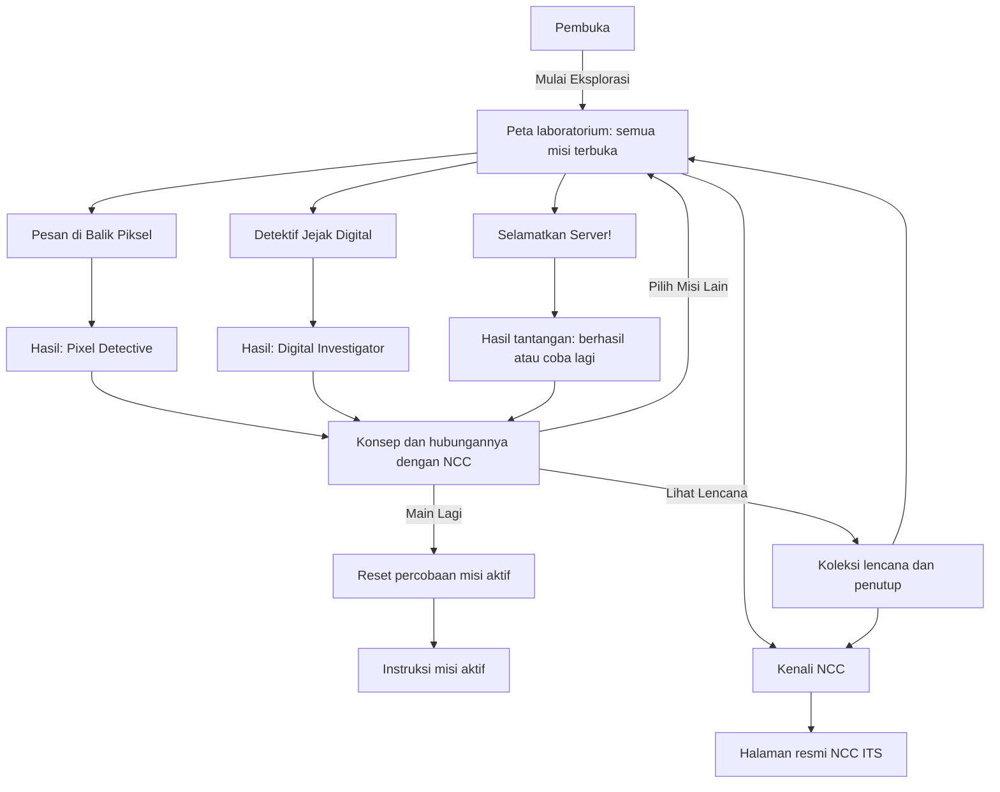
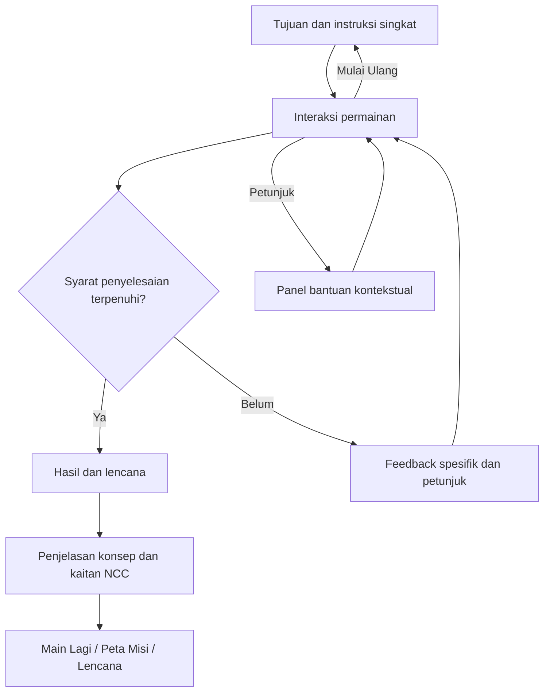
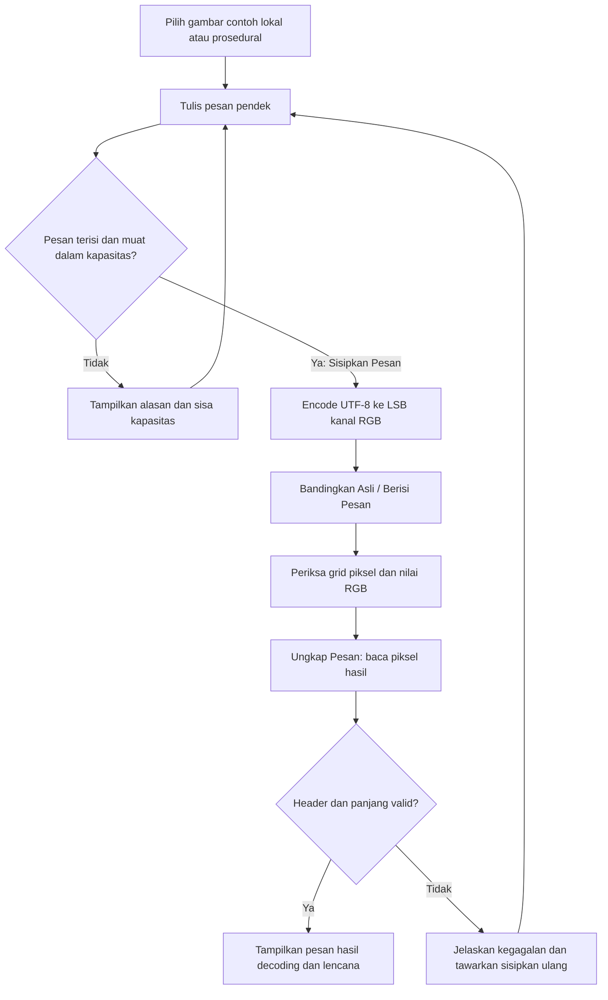
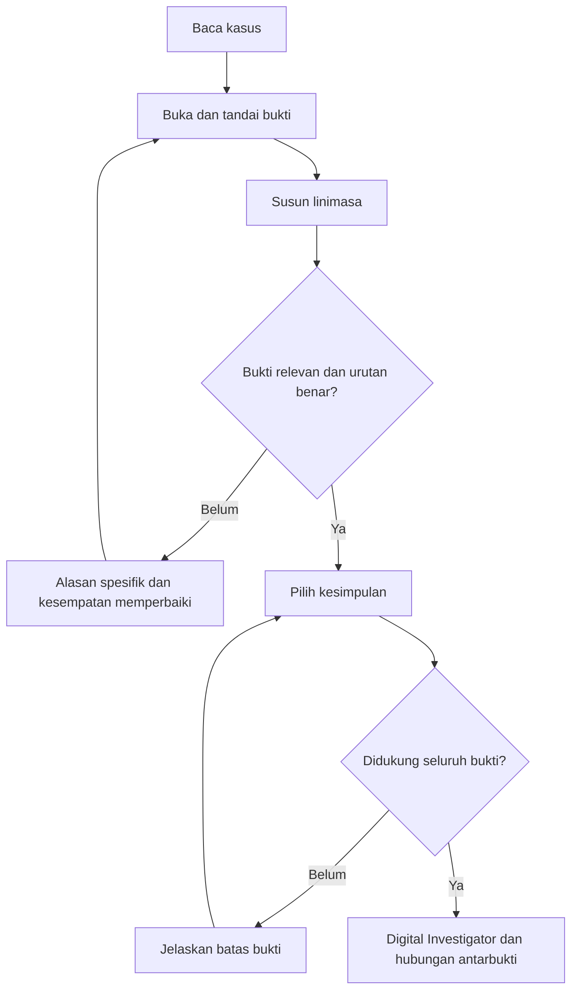
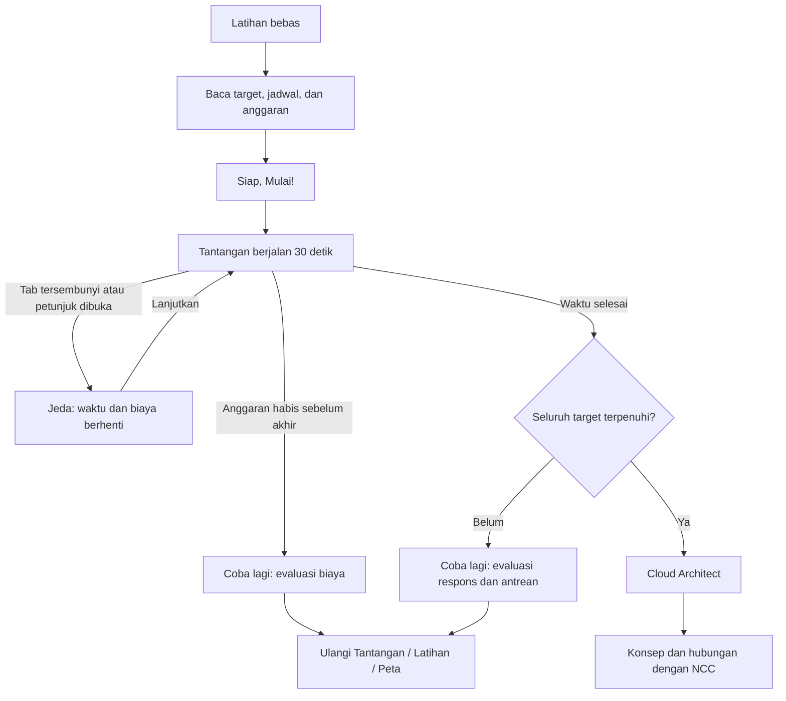
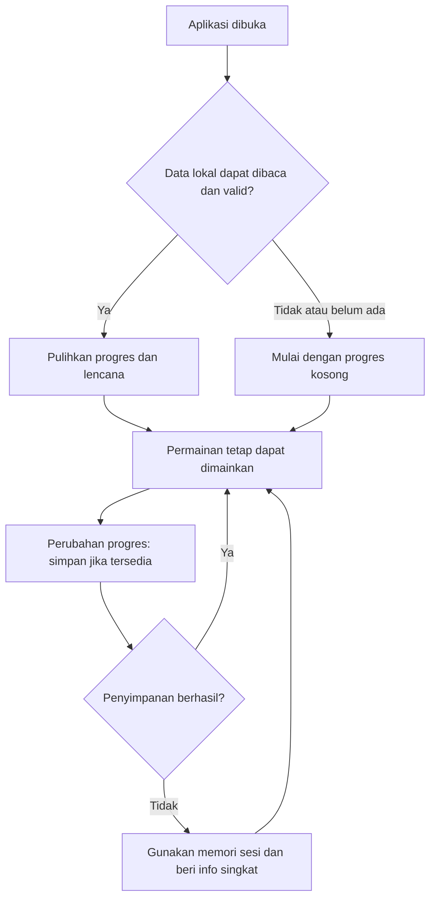

# Alur Website — NCC Digital Detective

## 1. Tujuan pengalaman

Pengunjung pameran menjadi detektif digital yang mencoba tiga bidang NCC melalui permainan singkat. Sasaran utama adalah siswa SMA tanpa pengetahuan teknis khusus, mayoritas menggunakan HP portrait. Setiap misi berdurasi sekitar 1–2 menit termasuk membaca instruksi dan hasil; tantangan server berlangsung 30 detik di dalam durasi tersebut.

Pengunjung bebas memilih satu, dua, atau tiga misi, memainkan ulang, lalu mengenal lab lebih lanjut. Tidak ada misi terkunci, urutan wajib, atau kewajiban mengumpulkan semua lencana.

## 2. Peta layar dan navigasi

Gunakan navigasi hash agar tautan layar dan tombol Back browser bekerja pada hosting statis tanpa konfigurasi server khusus.

| Layar | Lokasi usulan | Fungsi utama |
| --- | --- | --- |
| Pembuka | `#/` | Mengenalkan pengalaman dan mengajak mulai. |
| Peta laboratorium | `#/misi` | Memilih tiga stasiun dan melihat progres. |
| Pesan di Balik Piksel | `#/misi/piksel` | Menyisipkan dan mengungkap pesan dari gambar. |
| Detektif Jejak Digital | `#/misi/jejak` | Menandai bukti, menyusun linimasa, memilih kesimpulan. |
| Selamatkan Server! | `#/misi/server` | Latihan dan tantangan kapasitas layanan. |
| Koleksi lencana | `#/lencana` | Melihat pencapaian dan memilih misi berikutnya. |
| Kenali NCC | `#/tentang` | Membaca profil singkat dan membuka situs resmi. |

Hasil misi merupakan state dalam layar misi, sehingga konteks permainan tetap tersedia saat penjelasan hasil dibuka. URL tidak dikenal menampilkan pesan singkat dan tombol ke peta misi. Tautan langsung ke misi selalu dapat dibuka tanpa melalui pembuka.

Navigasi ringkas menyediakan Peta Misi, Lencana, dan Tentang NCC. Di misi, tombol **Kembali ke Peta** selalu tersedia. Perpindahan layar memindahkan fokus ke judul layar. Semua misi memiliki **Petunjuk** dan **Mulai Ulang**.

## 3. Pembuka dan peta laboratorium

### Pembuka

Urutan isi:

1. Emblem menggunakan logo NCC dari aset lokal [`ncc.png`](../ncc.png) yang diberikan pengguna, disertai teks “Laboratorium Net-Centric Computing — Departemen Teknik Informatika, Institut Teknologi Sepuluh Nopember”.
2. Judul **“Bongkar Rahasia Dunia Digital!”**
3. Deskripsi “Temukan pesan tersembunyi, telusuri jejak digital, dan jaga server tetap hidup bersama NCC ITS.”
4. Tombol utama **Mulai Eksplorasi** menuju peta.
5. Keterangan “Tanpa akun. Pilih misi apa saja. Sekitar 1–2 menit per misi.”
6. Ilustrasi laboratorium digital yang bereaksi ringan terhadap pointer atau sentuhan; tombol tetap dapat digunakan tanpa interaksi dengan ilustrasi.

Jika progres tersimpan, tampilkan jumlah lencana dan tautan **Lanjut ke Peta Misi**. Jangan membuka kembali percobaan lama secara otomatis.

### Peta laboratorium

Peta berupa tiga stasiun yang dihubungkan jalur jaringan. Pada HP, susun stasiun vertikal; pada desktop, gunakan komposisi laboratorium yang lebih luas. Setiap stasiun adalah tombol berlabel lengkap, bukan hanya area gambar.

| Stasiun | Deskripsi singkat | Bentuk visual | Status |
| --- | --- | --- | --- |
| Pesan di Balik Piksel | Sembunyikan pesanmu di dalam gambar, lalu bongkar kembali. | Meja pemindai, gambar, dan lensa grid piksel. | Belum dimainkan / Sedang dicoba / Selesai. |
| Detektif Jejak Digital | Hubungkan bukti untuk menjelaskan perubahan berkas sekolah. | Berkas investigasi dan sambungan linimasa. | Belum dimainkan / Sedang dicoba / Selesai. |
| Selamatkan Server! | Bagi permintaan agar gim sekolah tetap dapat diakses. | Server 2.5D dan jalur paket data. | Belum dimainkan / Sedang dicoba / Selesai. |

Status **Selesai** mengikuti perolehan lencana. Membuka misi menandainya **Sedang dicoba** bila belum selesai. Lencana yang sudah diperoleh tetap ada saat mengulang atau keluar di tengah percobaan.

## 4. Pola bersama setiap misi

- Instruksi ringkas berada dekat kontrol, dengan detail yang dapat dibuka kembali.
- Feedback tampil langsung di dekat tindakan dan melalui status aksesibel yang tidak membacakan setiap frame animasi.
- **Mulai Ulang** hanya mereset percobaan misi aktif; tidak menghapus lencana.
- **Petunjuk** menjelaskan langkah berikutnya tanpa mengurangi lencana atau memberi penalti.
- Keluar dari misi menghentikan loop, timer, dan listener. Percobaan aktif tidak disimpan lintas muat ulang; peta menyimpan status pernah dicoba dan pencapaian.
- Tidak perlu konfirmasi ketika berpindah misi. Jelaskan dekat tombol kembali: “Percobaan ini akan dimulai ulang saat dibuka kembali.”

## 5. Misi 1 — Pesan di Balik Piksel

### Alur interaksi

1. Tampilkan tujuan “Cari tahu bagaimana sebuah gambar bisa menyimpan pesan rahasia.”
2. Pilih salah satu dari tiga gambar prosedural: jaringan kota, gelombang digital, atau mosaik lab. Semua mengikuti palet.
3. Input berlabel **Pesan rahasia**, dengan contoh “Sampai jumpa di NCC!”. Tampilkan jumlah byte UTF-8 dan kapasitas; jumlah karakter dapat berbeda dari byte.
4. **Sisipkan Pesan** memproses salinan gambar asli. Saat berhasil, tampilkan “Kelihatannya sama, tetapi sebagian nilai pikselnya menyimpan pesanmu.”
5. Desktop menampilkan sebelum/sesudah berdampingan. HP menggunakan tombol **Asli** dan **Berisi Pesan** dengan area gambar berukuran tetap.
6. Ketuk/klik gambar untuk memilih piksel; kaca pembesar menampilkan grid terdekat, koordinat, dan nilai RGB asli serta hasil. Sediakan tombol arah untuk keyboard dan sentuhan.
7. Tampilkan contoh perubahan bit dari piksel yang benar-benar berubah, misalnya kanal bernilai 72 menjadi 73. Sediakan **Lihat Piksel yang Berubah** agar pengunjung tidak harus menemukannya secara acak.
8. **Ungkap Pesan** membaca ulang buffer piksel gambar hasil. Pesan yang terbaca ditampilkan pada panel hasil.
9. Penyisipan yang diikuti decoding valid memberikan **Pixel Detective**. Pemeriksaan piksel dianjurkan tetapi tidak menjadi penghalang penyelesaian.

### Aturan data dan kondisi tepi

- Satu bit per kanal RGB, urutan piksel dari kiri ke kanan lalu atas ke bawah; alpha tidak diubah.
- Format usulan: 4 byte penanda `NCC1`, 4 byte panjang payload unsigned big-endian, lalu byte pesan UTF-8. Bit setiap byte dibaca dari bit paling tinggi ke paling rendah.
- Kapasitas payload: `floor(lebar × tinggi × 3 / 8) − 8` byte. Batas UI pesan pendek: nilai terkecil antara 160 byte dan kapasitas payload.
- String kosong atau hanya spasi tidak dapat disisipkan. Isi pesan valid disimpan apa adanya tanpa normalisasi karakter.
- Decoder memeriksa penanda, panjang terhadap kapasitas, dan validitas UTF-8 sebelum menampilkan hasil. Format ini tidak menjamin deteksi semua kerusakan isi; jangan mengklaim sebagai pemeriksaan integritas atau keamanan.
- Mengubah pesan atau gambar membatalkan hasil encoding sebelumnya dan menonaktifkan **Ungkap Pesan** sampai penyisipan baru berhasil.
- Gambar asli dan hasil disimpan terpisah. Pembesaran membaca data gambar, tanpa smoothing yang mengaburkan sel piksel.
- Palet berlaku pada gambar dasar. Perubahan numerik maksimal satu pada kanal RGB karena LSB adalah data demonstrasi, bukan penambahan aksen visual baru.
- Unduhan opsional menggunakan PNG hasil encoding. Jika disediakan, tombol berfungsi dan menjelaskan bahwa konversi JPEG dapat merusak pesan.
- Bila Canvas tidak tersedia, tampilkan alasan misi ini tidak dapat dimainkan dan akses ke dua misi lain; jangan memberikan lencana palsu.

### Penjelasan setelah selesai

“Steganografi menyembunyikan keberadaan pesan di dalam media lain. Enkripsi menyamarkan isi pesan. Menyembunyikan pesan di gambar tidak otomatis membuatnya terenkripsi.”

**Hubungannya dengan NCC?** Steganografi berkaitan dengan keamanan informasi dan multimedia berbasis jaringan. Permainan ini merupakan ilustrasi edukasi, bukan alat pengiriman rahasia yang aman.

## 6. Misi 2 — Detektif Jejak Digital

### Kasus dan sumber bukti

Label tetap: **“Kasus simulasi — seluruh data fiktif”**.

Skenario: “Sebuah berkas proyek sekolah berubah tanpa diketahui pemiliknya. Telusuri jejak aktivitas untuk menemukan kejadian yang perlu diperiksa.”

Semua waktu berikut adalah WIB pada hari simulasi yang sama. ID sesi menghubungkan catatan, bukan membuktikan identitas seseorang.

| ID | Jenis bukti | Isi yang ditampilkan | Peran |
| --- | --- | --- | --- |
| E1 | Riwayat login | 09.00: akun `tim-proyek` login pada sesi `S-17`. | Awal sesi yang sedang diperiksa. |
| E2 | Informasi perangkat | 09.01: sesi `S-17` tercatat pada perangkat `Lab-03`, komputer bersama di ruang sekolah. | Konteks bahwa perangkat dapat dipakai banyak orang. |
| E3 | Waktu perubahan berkas | 09.04: `presentasi-proyek.pptx` tersimpan sebagai versi baru melalui sesi `S-17`. | Perubahan yang menjadi pusat investigasi. |
| E4 | Catatan aktivitas akun | 09.06: sesi `S-17` logout. | Batas akhir rangkaian sesi. |
| E5 | Aktivitas lain | 08.50: sinkronisasi otomatis `jadwal-kelas.pdf` oleh layanan `SYNC-2`. | Pengalih yang tidak terhubung langsung dengan perubahan berkas proyek. |

### Alur interaksi

1. Buka berkas kasus, baca masalah dan label simulasi.
2. Buka kartu bukti; pilih **Tandai Relevan**. Bukti terpilih masuk ke linimasa dengan urutan pemilihan, bukan otomatis diurutkan.
3. Susun E1 → E2 → E3 → E4 menggunakan **Naik** / **Turun**. Drag-and-drop boleh ditambahkan sebagai alternatif.
4. Menghapus tanda relevan mengeluarkan bukti dari linimasa. Perubahan pilihan atau urutan membatalkan hasil pemeriksaan sebelumnya.
5. **Periksa Linimasa** menjelaskan bukti kurang, bukti pengalih, atau urutan yang perlu diperbaiki. Jawaban keliru tidak mengunci permainan.
6. Setelah empat bukti relevan tersusun benar dan E5 dikeluarkan, tampilkan tiga pilihan kesimpulan.
7. **Periksa Kesimpulan** memberi alasan untuk jawaban yang dipilih. Jawaban keliru dapat diganti dengan linimasa tetap tersedia.
8. Kesimpulan benar memberikan **Digital Investigator**, lalu visual menghubungkan E1–E4 dengan ID sesi yang sama.

### Pilihan kesimpulan dan feedback

| Pilihan | Evaluasi | Feedback |
| --- | --- | --- |
| Berkas proyek berubah melalui sesi S-17 pada komputer bersama; pengguna sebenarnya masih perlu diperiksa. | Benar. | Login, perangkat, waktu perubahan, dan logout saling terhubung; identitas orang belum terbukti. |
| Pemilik akun pasti pelakunya karena nama akun muncul di riwayat. | Belum didukung. | Nama akun menunjukkan akun yang digunakan, bukan siapa yang mengoperasikannya. |
| Sinkronisasi otomatis 08.50 pasti mengubah berkas proyek. | Tidak didukung. | Catatan tersebut merujuk ke berkas dan layanan berbeda. |

Contoh petunjuk bertahap: “Cari ID sesi yang sama”, lalu “Perhatikan login sebelum perubahan, dan logout sesudahnya.” Jangan menggunakan alamat IP atau jenis perangkat sebagai bukti pasti identitas pelaku.

**Hubungannya dengan NCC?** Forensik digital menelusuri dan menghubungkan bukti untuk menjelaskan kejadian. Keamanan informasi dan jaringan juga mengkaji deteksi aktivitas yang perlu diperiksa.

## 7. Misi 3 — Selamatkan Server!

### Pengantar dan mode latihan

Skenario: “Gim daring buatan sekolahmu mendadak ramai. Atur server agar pemain tetap bisa masuk tanpa antre terlalu lama.”

Definisikan load balancer di dekat visual: “Pembagi permintaan yang mengarahkan pemain ke server.” Label angka: **“Simulasi pembelajaran; bukan benchmark infrastruktur nyata.”**

Mode awal adalah **Latihan**:

1. Pengunjung mengubah jumlah pengguna dengan slider 0–100, serta tombol tambah/kurang agar tidak bergantung pada gesture slider.
2. Pengunjung menambah/mengurangi 1–4 server dan memilih **Merata** atau **Menumpuk di Satu Server**.
3. Paket data mengikuti distribusi aktual. Beban mengubah indikator dan gerak server; antrean dan waktu respons mengikuti hasil simulasi.
4. Biaya latihan ditampilkan sebagai kredit per detik tanpa menguras saldo tantangan. Tampilkan “Anggaran tantangan: 90 kredit” sebagai pengantar.
5. **Mulai Tantangan** membuka ringkasan target, lalu **Siap, Mulai!** menginisialisasi percobaan baru. Latihan saja tidak memberikan lencana.

### Aturan simulasi yang diusulkan

Logika simulasi terpisah dari renderer, dengan langkah tetap 0,1 detik waktu simulasi. Angka berikut merupakan parameter edukasi yang dapat disesuaikan bersama kriteria penerimaannya saat implementasi.

| Parameter | Aturan |
| --- | --- |
| Permintaan | Satu pengguna menghasilkan satu permintaan per detik. |
| Kapasitas | Setiap server melayani maksimal 20 permintaan per detik. |
| Distribusi merata | Permintaan baru dibagi sama rata ke semua server aktif. |
| Distribusi menumpuk | Semua permintaan baru masuk ke server aktif pertama. |
| Antrean | Per server: `Q_baru = max(0, Q_lama + permintaan_masuk × dt − 20 × dt)`. |
| Beban | Kebutuhan pelayanan `(Q_lama / dt + permintaan_masuk) / 20`, dibatasi 0–100% untuk indikator. Antrean tetap ditampilkan agar kelebihan kapasitas terlihat. |
| Waktu respons ilustratif | `0,2 + max(Q_i / 20)` detik pada seluruh server aktif; tampilkan sebagai estimasi server tersibuk. |
| Menghapus server | Antreannya dipindah ke server tersisa sesuai mode distribusi; permintaan tidak dihapus. Server pertama tidak dihapus selama server lain masih ada. |
| Menambah server | Kapasitas tersedia langsung; antrean lama tetap di server asal dan permintaan baru mengikuti distribusi saat ini. |
| Mengubah distribusi | Mengubah tujuan permintaan baru, tidak menghilangkan antrean lama. |
| Biaya tantangan | Satu kredit per server per detik waktu simulasi; saldo awal 90 kredit, tanpa biaya pemasangan. |

Paket visual boleh mewakili beberapa permintaan demi performa, dengan kepadatan proporsional terhadap laju aktual. Penghitungan antrean tidak bergantung pada jumlah partikel atau frame layar.

### Tantangan 30 detik

Sebelum mulai, tampilkan target: **“Jaga respons ≤1 detik selama minimal 24 dari 30 detik, sisakan antrean maksimal 20 permintaan saat selesai, dan jangan habiskan anggaran sebelum waktu berakhir.”**

Tantangan dimulai dengan dua server, distribusi merata, antrean nol, dan saldo 90 kredit. Slider pengguna tidak aktif karena lonjakan diatur permainan. Kontrol server dan distribusi tetap aktif.

| Waktu simulasi | Pengguna / permintaan per detik | Penjelasan visual |
| --- | --- | --- |
| 0 ≤ t < 8 detik | 20 | Pemain mulai masuk. |
| 8 ≤ t < 16 detik | 50 | Gim mulai dibagikan teman. |
| 16 ≤ t < 24 detik | 70 | Puncak lonjakan pemain. |
| 24 ≤ t ≤ 30 detik | 30 | Lalu lintas mulai turun. |

Tampilkan jadwal lonjakan sebelum mulai dan penanda fase saat bermain. Jadwal tidak acak. Satu strategi acuan yang layak: 2 → 3 → 4 → 2 server pada batas fase, distribusi merata; total biaya 84 kredit dan antrean nol dalam model ideal. Empat server sepanjang permainan memerlukan 120 kredit sehingga anggaran punya konsekuensi nyata.

- Hitung durasi respons ≤1 detik dari langkah simulasi, bukan dari pembulatan angka di layar.
- Ketika biaya langkah akan melewati nol, hentikan tepat pada waktu saldo habis. Jika waktu itu <30 detik, hasil gagal; saldo nol tepat di akhir boleh memenuhi syarat anggaran.
- Hasil menampilkan durasi respons sesuai target, antrean akhir, dan saldo, dengan penjelasan syarat yang terpenuhi atau belum terpenuhi.
- **Ulangi Tantangan** mengembalikan waktu, server, distribusi, antrean, dan saldo ke kondisi awal. **Kembali ke Latihan** membuka latihan bersih.
- Saat tab kembali terlihat, tampilkan overlay **Lanjutkan**. Jangan mengejar waktu yang terlewat. Panel petunjuk memakai mekanisme jeda yang sama.
- Saat beberapa penyebab jeda bertumpuk, permainan baru lanjut setelah semuanya ditutup dan pengunjung memilih **Lanjutkan**. Tidak ada biaya selama jeda.

**Hubungannya dengan NCC?** Cloud dan sistem terdistribusi mengatur layanan pada beberapa mesin. Pembagian beban membantu memakai kapasitas, sedangkan penambahan server meningkatkan kapasitas sekaligus biaya.

## 8. Hasil, koleksi lencana, dan profil NCC

### Panel hasil

Urutan hasil setiap misi: status berlabel dan ikon → ringkasan tindakan serta hasil nyata → lencana bila berhasil → penjelasan konsep → **Hubungannya dengan NCC?** → **Pilih Misi Lain**, **Main Lagi**, **Lihat Lencana**.

Kegagalan tantangan server tetap menampilkan pelajaran dan akses ke misi lain. Lencana hanya diberikan ketika syarat berhasil terpenuhi. Perolehan ulang tidak menambah duplikat.

### Koleksi lencana dan penutup

Tampilkan tiga emblem SVG custom: **Pixel Detective**, **Digital Investigator**, **Cloud Architect**. Lencana belum diperoleh menampilkan nama, syarat singkat, dan tombol menuju misinya; gunakan label “Belum diperoleh”, bukan status misi terkunci.

Tampilkan progres **0/3** sampai **3/3**, tanpa kewajiban melengkapinya. Kalimat penutup: **“Tertarik membangun dunia digital yang aman dan terhubung?”** Diikuti tombol **Kenali NCC Lebih Lanjut** dan **Kembali ke Peta**.

### Profil lab

Gunakan informasi yang diberikan dalam brief:

- NCC adalah Laboratorium Net-Centric Computing atau Komputasi Berbasis Jaringan di Departemen Teknik Informatika ITS.
- Bidangnya mencakup sistem terdistribusi, cloud, keamanan informasi dan jaringan, forensik digital, komputasi bergerak, jaringan sensor, serta multimedia berbasis jaringan.
- Contoh topik riset meliputi steganografi, deteksi serangan siber, dan forensik drone.
- Permainan merupakan ilustrasi edukasi untuk mengenalkan sebagian bidang lab.

Tautan **Kenali NCC Lebih Lanjut** mengarah ke [halaman resmi NCC ITS](https://www.its.ac.id/informatika/en/net-centric-computing-laboratory/). Jika dibuka pada tab baru, sampaikan lewat label aksesibel. Tidak menambahkan klaim dosen, fasilitas, prestasi, kontak, atau kerja sama. Logo ITS ditampilkan hanya jika aset resminya tersedia; sementara gunakan nama institusi dalam teks.

## 9. Progres dan mode pameran

Simpan data minimal pada key berversi, misalnya `ncc-digital-detective:v1`: versi skema, ID misi pernah dicoba, dan ID lencana yang diperoleh. Jangan menyimpan teks pesan, data pribadi, buffer gambar, atau percobaan permainan aktif.

Data rusak atau versi tidak dikenal diabaikan dengan aman. Jika localStorage tidak tersedia, progres bertahan selama aplikasi masih terbuka, dengan keterangan “Progres hanya tersimpan selama sesi ini.” Jangan menghentikan permainan.

Tombol **Pengunjung Baru** tersedia di peta dan koleksi lencana:

1. Dialog: “Hapus progres dan lencana di perangkat ini untuk pengunjung berikutnya?”
2. Pilihan **Batal** dan **Hapus & Mulai Baru**, dengan fokus awal pada Batal.
3. Batal atau Escape menutup dialog dan mempertahankan progres serta fokus pemicu.
4. Konfirmasi menghapus hanya key aplikasi ini, membersihkan progres memori dan percobaan aktif, lalu kembali ke pembuka.
5. Jika penghapusan storage ditolak browser, sesi direset dan diberi info bahwa progres lama mungkin muncul setelah muat ulang. Jangan menjanjikan penghapusan persisten yang gagal.

## 10. Tata letak, visual, dan aksesibilitas

### Palet wajib

| Token | Nilai | Pemakaian |
| --- | --- | --- |
| Background | `#080613` | Latar utama dan teks pada tombol pink. |
| Panel | `#0E1D5A` | Navigasi dan area permainan. |
| Surface | `#293A81` | Permukaan interaktif dan kontrol sekunder. |
| Data | `#4876B8` | Jalur jaringan, paket, dan proses. |
| Muted | `#A99CD5` | Teks sekunder dan detail. |
| Foreground | `#E5D6F7` | Teks utama dan highlight. |
| Action | `#FF3B86` | Aksi utama, seleksi, dan pencapaian. |

Gradasi dan transparansi berasal dari palet ini. Berhasil, peringatan, dan gagal memakai ikon serta label; tidak menambahkan hijau, kuning, atau merah sebagai aksen baru. Periksa kontras pasangan teks/latar, termasuk tombol pink dengan teks gelap. Glow tidak menjadi sumber keterbacaan utama. Warna bawaan logo NCC yang diberikan pengguna dipertahankan sebagai pengecualian aset identitas; tidak dijadikan aksen tambahan untuk antarmuka.

### Emblem dan aset identitas NCC

- Sumber emblem adalah [`ncc.png`](../ncc.png) di root proyek, menggantikan rencana emblem tipografi buatan sendiri.
- Gunakan pada pembuka, identitas navigasi, dan profil lab dengan proporsi asli, tanpa distorsi, pemotongan, atau pewarnaan ulang.
- Tempatkan pada bidang dengan kontras yang memadai agar garis luar dan tulisan logo terbaca. Efek glow atau animasi ringan diterapkan pada wadah, bukan mengubah gambar logo.
- Pada navigasi HP, beri ruang yang cukup dan tampilkan nama lab sebagai teks pendamping bila tulisan kecil dalam gambar sulit dibaca.
- Gunakan alt text “Logo Laboratorium Net-Centric Computing (NCC)”; jika gambar hanya dekoratif dan nama yang sama sudah menjadi label di sebelahnya, gunakan alt kosong untuk menghindari pembacaan berulang.
- Saat implementasi, siapkan salinan aset berukuran sesuai kebutuhan tampilan untuk mengurangi unduhan; pertahankan file sumber. Tidak perlu menggambar ulang atau menghasilkan logo dengan AI.
- Ketiga lencana misi tetap berupa SVG custom yang berbeda dari emblem identitas NCC.

### Susunan layar

| Area | HP 360–430 px | Desktop |
| --- | --- | --- |
| Misi | Judul → tujuan → instruksi → permainan → kontrol → feedback. | Permainan dan panel instruksi/kontrol berdampingan. |
| Piksel | Tombol Asli/Berisi Pesan, satu gambar aktif, pembesar di bawah. | Dua gambar sejajar dan pembesar di samping/bawah. |
| Forensik | Berkas bukti diikuti linimasa vertikal, tombol Naik/Turun. | Meja bukti dan linimasa berdampingan. |
| Server | Jalur pengguna → pembagi → server menyesuaikan lebar; indikator ringkas di bawah. | Visual jaringan luas, indikator dan kontrol di samping. |
| Hasil | Bagian lanjutan di layar yang sama, fokus ke judul hasil. | Panel hasil memperluas penjelasan tanpa menutupi kontrol keluar. |

- Target sentuh minimal 44 × 44 px; ukuran teks isi sekitar 16 px; tanpa horizontal scroll.
- Semua kontrol dapat dijangkau keyboard, dengan focus indicator dan label yang jelas. Tidak bergantung pada hover atau drag.
- Canvas memiliki ringkasan tekstual dan kontrol DOM setara: arah piksel, nilai RGB, serta indikator server.
- Panel/modal mengelola fokus dan mengembalikannya ke pemicu. Pesan kesalahan dikaitkan dengan input.
- Sentuhan pada gambar memilih koordinat; tidak memerlukan drag terus-menerus yang mengganggu scroll.
- `prefers-reduced-motion` mengurangi perpindahan dan paket bergerak sambil menjaga data, kontrol, serta informasi distribusi tetap tersedia.
- Tidak menggunakan emoji atau stock image sebagai ilustrasi utama. Tiap misi memiliki komposisi khusus; bukan deretan kartu seragam.
- SVG dan Canvas 2D cukup untuk cakupan awal; 3D/WebGL dan audio tidak diperlukan untuk alur ini.

## 11. Performa dan batas perilaku

- Muat modul misi ketika rutenya dibuka, dengan indikator memuat dan tombol coba lagi jika pemuatan gagal.
- Batasi device pixel ratio renderer, misalnya maksimal 2; resolusi data gambar steganografi tetap terpisah dari ukuran tampilan dan DPR.
- Batasi jumlah paket dekoratif; logika simulasi tetap berjalan berdasarkan waktu simulasi dan kapasitas.
- Hentikan animasi saat layar tidak aktif atau tab tersembunyi; bersihkan timer, listener, dan animation frame saat keluar.
- Penyisipan dan decoding memakai gambar lokal/prosedural sehingga tidak bergantung pada pengambilan gambar eksternal atau Canvas lintas origin.
- Seluruh misi berjalan tanpa backend setelah aset aplikasi termuat. Akses pertama tanpa internet tidak dijanjikan karena belum ada kebutuhan service worker/cache offline.
- Dokumen ini menjadi acuan alur implementasi lokal. Kriteria penerimaan tersedia dalam [rencana verifikasi](verification-plan.md), dan pemeriksaan yang sudah dijalankan dicatat pada [hasil verifikasi](verification-results.md).
